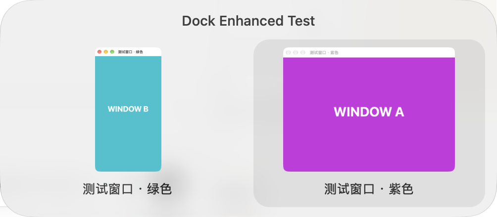

# Dock Enhanced

给 macOS 增加窗口级 Command+Tab 切换、Dock 点击收起/恢复，以及悬停窗口预览。

## 使用

1. 将 `dist/Dock Enhanced.app` 放入“应用程序”，双击打开。此电脑已安装在 `/Applications/Dock Enhanced.app`；重启后可从“应用程序”打开，或在 Spotlight 搜索 `Dock Enhanced`。
2. 在设置的“通用 → 系统权限”中，授权**辅助功能**和**屏幕录制**。辅助功能用于操作窗口与识别切换快捷键；屏幕录制只用于生成缩略图，未授权也可使用图标和标题切换。
3. 授权后，菜单栏显示“正在运行”。若缩略图仍不可用，退出并重新打开应用。

| 操作 | 结果 |
| --- | --- |
| 快按 Command+Tab 后松开 | 返回上一个具体窗口，不闪出面板 |
| 按住 Command 并按 Tab／Shift+Tab | 显示多行窗口面板，正向／反向选择 |
| 方向键、Enter、鼠标 | 按网格选择；Enter 或点击确认，Esc／外部点击取消 |
| 点击前台应用的 Dock 图标 | 最小化最近使用的一个窗口 |
| 再次点击 | 恢复刚才最小化的同一个窗口 |
| 点击后台应用的图标 | 沿用系统行为，切换到应用 |
| 悬停约 0.40 秒（默认，可调） | 显示该应用的窗口预览 |
| 点击缩略图 | 恢复并切换到对应窗口 |

预览使用简约玻璃面板，macOS 26 及以上采用原生 Liquid Glass，较早系统使用毛玻璃。应用名和窗口标题居中显示，悬停只增加柔和的明暗反馈，没有彩色边框。预览出现和消失采用短暂淡入淡出。系统开启“减少动态效果”时会减少位移动效。点击或右键后，同一图标的预览保持关闭，移开鼠标再悬停才重新出现。设置页可调整预览停留时间。

应用在后台运行，不显示自己的 Dock 图标。设置中的“登录时启动”可开启或关闭开机登录后自动运行；状态直接读取系统登录项，若系统要求允许，可点击设置里的入口前往确认。自启从已安装的应用位置运行，请保持 `/Applications/Dock Enhanced.app` 不变。

设置中的“隐藏菜单栏图标”默认关闭，切换后立即生效并保存。隐藏图标不影响预览、点击功能或登录自启。隐藏后，按 `⌘ 空格` 搜索 `Dock Enhanced` 并打开，或从“应用程序”双击应用，即可进入设置；应用已运行时也会打开设置。手动启动总会显示设置，权限齐全的登录自启保持安静。设置页底部提供“退出 Dock Enhanced”，也可关闭隐藏开关来恢复菜单栏入口。

设置采用三页侧栏：“Dock 功能”默认打开，放置原有两个功能开关，预览开启时才显示停留时间；“窗口切换”管理 Command+Tab 增强并分别说明控制能力和缩略图状态；“通用”分为“启动与显示”和“系统权限”。缺失权限的功能提供跳转入口，已授权项目只显示简洁状态。侧栏底部始终显示运行状态、版本和退出入口，窗口可调整大小。

设置和菜单栏提供“悬停预览”“点击收起 / 恢复”“Command+Tab 增强”三个独立开关，状态分别保存。关闭悬停预览立即收起 Dock 小窗；仍开启的窗口切换继续使用缩略图。两种图像消费者都关闭时才停止截图并清空缓存；只启用点击功能无需屏幕录制权限。三项全关闭会暂停服务并清理未完成的选择和激活。升级时，原有两项未单独设置的开关沿用旧总开关，新增强未设置时始终默认开启，显式关闭后保持关闭。

“窗口切换”页会区分增强可用、仅图标与标题可用、控制权限缺失和快捷键监听不可用。辅助功能未授权、完整键盘事件未开放、监听停用或安全输入期间不接管系统 Command+Tab。正常切换不会重复弹出授权请求。监听中断、控制能力丢失或检测到 Command 松键事件丢失时取消本轮选择，后续完整快捷键可重新开始。已拦截的旧输入不会重放。恢复失败会短暂显示“无法切换到此窗口，请重试”，不会自动选择其他窗口。

菜单栏还提供“设置”和“退出”。点击其他窗口或进行键盘操作后，下次 Dock 点击重新以最近使用的窗口为目标。Command+Tab 增强只识别切换操作需要的物理按键与修饰键；其他键盘活动仅用于取消过期恢复，不读取或记录输入文字。带修饰键的点击、右键菜单及拖动图标沿用系统操作。



## 边界

- macOS 14 及以上。本次本机打包为 Apple Silicon 版本。
- 全屏窗口、不可最小化窗口和未运行应用沿用原生 Dock 行为。
- Command+Tab 增强可恢复隐藏应用及最小化窗口，也会保留本次运行中已识别的普通／全屏窗口。若工具启动时应用已经全屏，macOS 可能暂不提供该应用此前未被工具识别的普通窗口；这些窗口此时不会出现在清单中。先退出全屏一次，让工具识别普通窗口，再进入全屏后便可保留并选择。此发现边界已明确记录；不会使用标题或位置猜测缺失窗口。
- 最小化窗口使用最后一次缓存画面；没有缓存时显示应用图标和窗口标题。
- 不显示重复的辅助功能窗口条目、无标题的后台内部辅助窗口。正常的无标题窗口仍会显示。
- 恢复最小化窗口时，会在窗口就绪后完成前台激活；新的鼠标或键盘操作会取消尚未完成的激活，避免抢回焦点。
- 缩略图仅存在内存中，最多保留 64 张；撤销录屏权限、关闭两种图像消费者、暂停或退出会清除可见图片和缓存，并丢弃在途截图。窗口标题和窗口使用历史也不写入磁盘。应用没有网络请求。
- 不同应用对辅助功能的支持可能不同。原生集成已用两个独立 AppKit 窗口验证；多显示器、不同 Dock 方向、自动隐藏和各第三方应用仍需实际兼容性检查。
- 本地应用使用临时签名。首次安装或重新构建后，系统可能要求重新授权。建议在固定位置运行。

## 从源码构建

需要 Swift 6 工具链和 macOS Command Line Tools，不依赖第三方库。

```sh
scripts/build-app.sh
```

生成 `dist/Dock Enhanced.app`。构建脚本使用 SwiftPM 的原生构建方式，兼容本机仅安装 Command Line Tools 的环境。

应用图标在 `assets/AppIcon.icns`，1024 像素原图在 `assets/AppIcon.png`。图形源文件为 `scripts/generate-icon.swift`；运行 `swift scripts/generate-icon.swift .build/icon-assets` 可重新生成全部标准尺寸及 Retina 图标。构建时将 ICNS 复制进应用并写入图标声明。

## 验证

```sh
swift run --build-system native DockCoreChecks
scripts/check-native.sh
swift run --build-system native DockEnhanced --check-chrome-preview
swift run --build-system native DockEnhanced --check-window-count com.openai.codex 1 --select --from-app com.apple.mail --minimized
```

第一条验证点击行为入口，包括多窗口选择、连续最小化/恢复、已关闭窗口、后台应用和不支持的窗口。

第二条启动专用的双窗口测试应用和独立来源夹具，验证真实 Dock 悬停、画面捕获、缩略图选择、最小化、缓存预览和恢复，以及两个功能开关的四种组合。测试会短暂移动鼠标与切换测试窗口，完成后退出测试应用并恢复原来的鼠标位置与前台应用；请在桌面空闲时运行。需要当前运行环境已获得辅助功能和屏幕录制权限。

第三条检查实际 Chrome 可见窗口是否生成了缩略图；不会输出网页标题、网址或保存网页截图。没有可见 Chrome 窗口时返回“检查不可用”。

第四条是本机 ChatGPT 的最小化恢复检查（本机应用标识为 `com.openai.codex`），需 ChatGPT 只有一个正常窗口且邮件已运行。也可替换目标标识、预期数量和来源应用标识。检查实际点击预览后，窗口已展开并保持前台；缺少目标预览或未实际触发选择时返回“检查不可用”。会恢复原来的最小化状态、前台应用和鼠标位置，不记录窗口标题或正文。运行前退出已运行的 Dock Enhanced，避免两份窗口控制工具相互干扰。

## 开发入口

- `Sources/DockCore`：可独立验证的点击行为。
- `Sources/DockEnhanced`：原生 Dock 识别、窗口操作、预览与菜单栏。
- `.scratch/dock-enhancement/spec.md`：已确认的功能范围。
- `.scratch/dock-enhancement/feasibility.md`：官方 API 来源与兼容性边界。

### Command+Tab 原生检查

运行 `scripts/check-switcher-native.sh`，会启动两个专用多窗口测试应用，通过真实系统事件检查快捷键接管、浏览不激活、最小化后的指定窗口恢复、同应用窗口选择、隐藏应用的浏览／取消／确认、隐藏加最小化的独立恢复，以及已关闭目标不错误激活其他窗口。检查需要当前环境已有辅助功能与事件发送能力，不会申请或更改系统权限。完成后关闭夹具并恢复先前的前台窗口。请避免同时运行其他窗口检查或另一个 Dock Enhanced 实例。

加上 `--reachability` 会让受控窗口进入全屏，验证已识别的同应用普通窗口与全屏窗口通过真实 Command+Tab 双向切换；目标的准确焦点与实际活动 Space 可见性分别核对。另启空历史进程复现全屏冷启动的窗口发现边界。当前 AppKit 夹具已通过上述可运行场景；两个普通桌面之间、物理多显示器、其他应用与其他系统版本的完整兼容性仍未验证，不能把普通桌面与全屏 Space 的通过扩大为全部桌面场景。详见 [原生范围与证据](.scratch/command-tab-enhancement/validation/02-native-reachability.md)。

### 图像、偏好与共享服务检查

`swift run --build-system native DockEnhanced --check-preview-settings` 在隔离的偏好域和受控截图边界验证迁移、跨进程保存、异步图片、最小化缓存、撤权、重新授权和 64 张缓存上限，不显示窗口、不读取或捕获用户内容。

`swift run --build-system native DockEnhanced --check-feature-services` 检查真实事件监听与三个开关的全部八种组合，以及共享图片生命周期。截图访问与图片返回在系统边界受控，不改变用户授权，也不捕获桌面像素。它会短暂创建全局事件监听并显示一张合成测试卡片，请与其他原生窗口检查串行运行。这两项检查不能代替真实权限撤销、系统授权变更或合成视觉验收。

### 异常恢复与整体验证

异常检查入口为 `scripts/check-switcher-native.sh --recovery`：使用实际 AX 窗口和系统输入，检查松键观察丢失、两类监听停用、控制能力丢失／返回、安全输入、窗口关闭／新建、三种确认后的旧恢复取消及失败提示。控制权限丢失在系统查询边界注入，未撤销用户真实权限；安全输入由临时夹具实际开启和关闭。慢 AX 检查只暂停并恢复专用夹具。

`scripts/check-switcher-native.sh --review` 验证空候选时的快捷键消费与不可用时的透传、同屏可用几何变化后的重排，以及重复开关窗口后的身份清理和全屏保留。几何变化仅在系统查询边界注入，不修改真实显示设置；窗口创建／关闭、辅助功能超时和全屏状态使用专用原生夹具。

`scripts/check-switcher-native.sh --visual` 采集专用窗口的真实缩略图，保存单卡、单行、多行、滚动及明暗合成截图；`swift run --build-system native DockEnhanced --check-settings-visual` 实际点击三个设置页与增强开关，在隔离偏好中验证保存与重开。它不启动控制服务或图像消费者，不更改真实权限或登录项。截图范围下方有不透明受控背景，不包含用户窗口。

本次宿主为 macOS 27.2、单个 2× 显示器；真实安全输入、已识别全屏窗口与普通窗口的双向切换已验证。两个普通桌面、物理多显示器、其他系统版本和快捷键工具冲突没有冒充通过。完整结果、基线差异和 62 条用户故事覆盖见 [整体验证记录](.scratch/command-tab-enhancement/validation/05-integrated-validation.md)。
