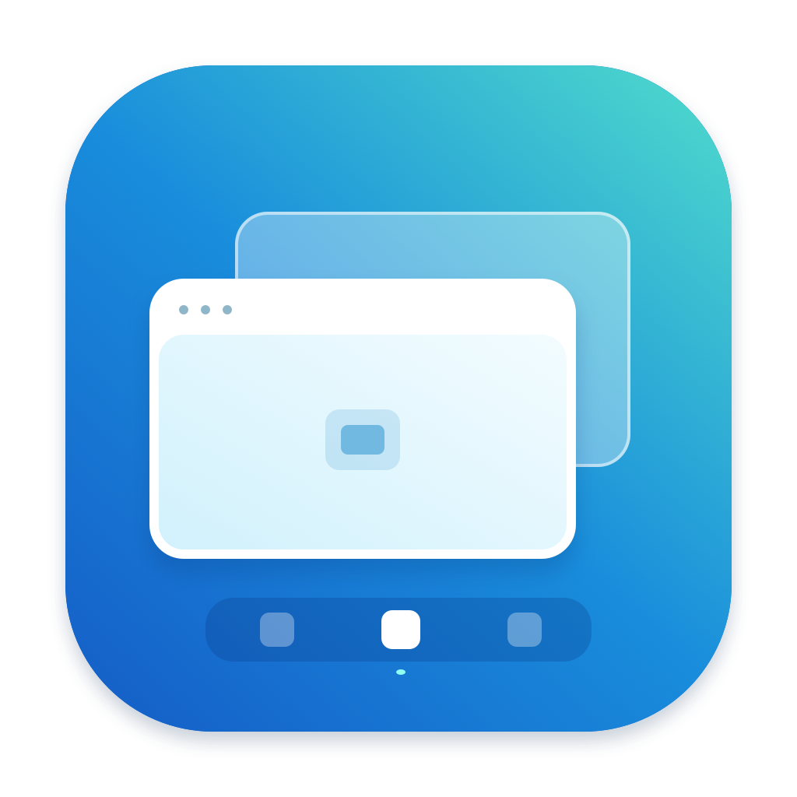
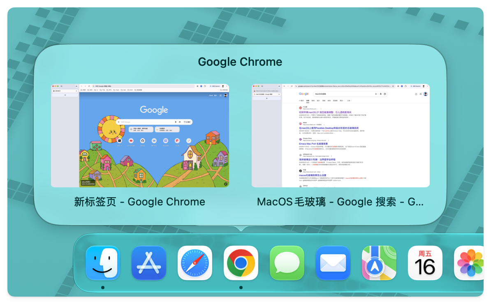
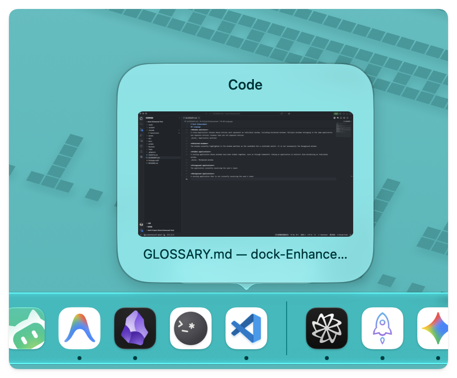
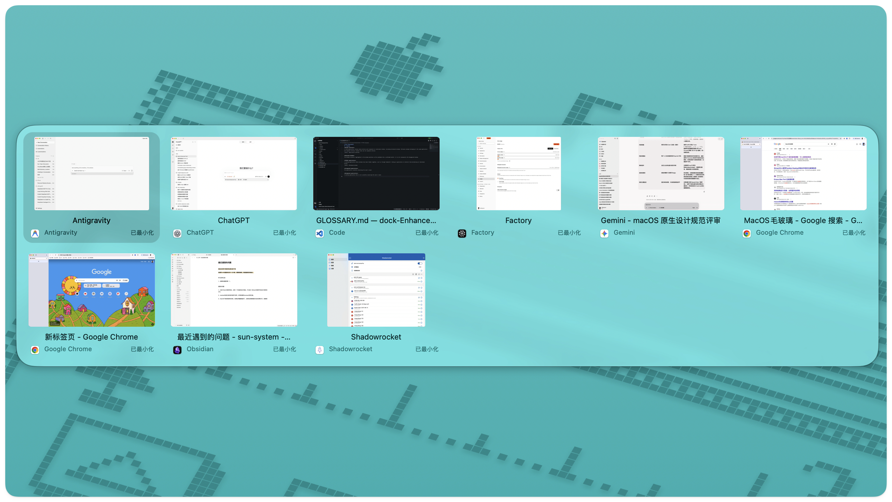

<div align="center">
  

# Dock Enhanced

[English](README.md) · **简体中文**

让 macOS 的窗口切换更顺手。

**Dock 悬停预览 · 点击收起与恢复 · 窗口级 Command+Tab**

[下载应用](https://github.com/sunyifeng11111/yf-dock-enhanced/releases/latest) · [功能预览](#功能预览) · [快速开始](#快速开始) · [操作指南](#操作指南) · [从源码构建](#从源码构建)

</div>

Dock Enhanced 是一款原生 macOS 窗口工具。把鼠标移到 Dock 图标上，即可查看并选择具体窗口；点击前台应用图标，可收起或恢复最近使用的窗口；按下 `⌘ Tab`，可直接在各应用的窗口之间切换。

应用在后台运行，不占用 Dock 位置。三项增强可独立开启，使用 Swift、AppKit 和 SwiftUI 构建，无第三方库依赖。

## 功能预览

### 悬停 Dock，找到具体窗口

同一应用开了多个窗口？悬停 Dock 图标即可查看窗口缩略图和标题，点击预览直接切换。默认停留 **0.4 秒**后显示，可在设置中调整。



只有一个窗口时，预览自动使用紧凑布局。



### Command+Tab，按窗口切换

每张卡片代表一个窗口。同一应用的多个窗口分别列出，支持选择已最小化的窗口和隐藏应用的窗口。快速按下并松开 `⌘ Tab`，直接返回上一个窗口；按住 Command 则展开面板，继续浏览。



> [!NOTE]
> 切换列表以窗口为单位，浏览器标签页不会单独列出。

### 点击 Dock，收起与恢复

点击前台应用的 Dock 图标，最小化该应用最近使用的一个窗口；再次点击，恢复同一个窗口。点击后台应用时，仍按系统方式切换到该应用。

预览采用玻璃面板：macOS 26 及以上使用原生 Liquid Glass，较早系统使用毛玻璃，并适配系统的“减少动态效果”设置。

## 快速开始

需要 **macOS 14 或更高版本**。可下载的 DMG 为 Apple Silicon（arm64）版本，暂未提供 Intel 二进制包；从源码构建会使用当前机器的原生架构。

1. 从 [GitHub Releases](https://github.com/sunyifeng11111/yf-dock-enhanced/releases/latest) 下载 Apple Silicon 版本的 `.dmg`。
2. 打开 DMG，将 **Dock Enhanced.app** 拖入“应用程序”，再双击应用打开。
3. 在应用设置的 **通用 → 系统权限**中完成授权。

| 权限 | 用途 |
| --- | --- |
| 辅助功能 | 操作窗口、识别 Dock 点击与窗口切换快捷键 |
| 屏幕录制 | 生成 Dock 预览和窗口切换面板的缩略图 |

> [!IMPORTANT]
> 未授予屏幕录制权限时，窗口切换仍可使用图标和标题；仅使用点击收起／恢复无需该权限。授权后若缩略图仍未出现，请退出并重新打开应用。

从 **0.6.5** 起，发布包使用固定自签证书。应用尚未经过 Apple 公证，macOS 仍可能拦截下载的应用或显示安全提示。

**从 0.6.4 及更早的临时签名版本升级时，需要重新授权一次**。后续使用同一证书签名的更新旨在保留已有权限；维护者已在本机用独立测试应用验证两个版本的权限保留，其他系统版本仍需验证。建议固定放在“应用程序”，更新前先退出、替换后再打开。使用者无需把签名证书安装到钥匙串。

## 操作指南

| 操作 | 效果 |
| --- | --- |
| 悬停 Dock 图标 | 显示该应用的窗口预览 |
| 点击预览缩略图 | 恢复并切换到对应窗口 |
| 点击前台应用的 Dock 图标 | 收起最近使用的窗口，再次点击恢复 |
| 快按 `⌘ Tab` 并松开 | 返回上一个具体窗口，不展开面板 |
| 按住 `⌘`，连续按 `Tab` | 展开面板并向后选择窗口 |
| 按住 `⌘`，按 `Shift Tab` | 反向选择窗口 |
| 方向键或鼠标 | 在面板中选择窗口 |
| 松开 `⌘`、按 `Enter` 或点击卡片 | 确认切换 |
| 按 `Esc` 或点击面板外部 | 取消选择 |

### 按自己的习惯设置

从菜单栏打开“设置”，三个页面分别管理：

- **Dock 功能**：独立开关悬停预览、点击收起／恢复，调整预览停留时间。
- **窗口切换**：开关 Command+Tab 增强，查看快捷键与缩略图的可用状态。关闭后恢复系统 Command+Tab。
- **通用**：切换界面语言，管理登录时启动、隐藏菜单栏图标和系统权限。

隐藏菜单栏图标后，可通过 Spotlight 搜索 `Dock Enhanced`，或再次从“应用程序”打开，进入设置。设置侧栏底部提供退出入口。

### 界面语言

在 **设置 → 通用 → 语言 → 界面语言** 中选择 **English** 或 **简体中文**。设置页、菜单栏以及应用自身的预览和窗口切换提示会立即切换，无需重启，选择会保存到下次启动。首次启动时，中文系统使用简体中文，其他系统语言使用英文。应用名称、真实窗口标题及 macOS 授权对话框保持原文或系统语言。

## 隐私与兼容性

- **本地处理**：应用没有网络请求；缩略图只保存在内存中，最多缓存 64 张，窗口标题和使用历史不写入磁盘。停止图像服务、撤销录屏权限或退出时清除图像缓存。
- **最小化窗口**：预览使用最后缓存的画面；没有缓存时显示应用图标和窗口标题。
- **原生 Dock 操作**：右键、拖动和带修饰键的点击沿用系统行为；点击收起功能不处理全屏或不可最小化的窗口。
- **快捷键可用性**：缺少控制权限、监听不可用或处于安全输入状态时，不接管系统 Command+Tab。快捷键增强不读取或记录输入文字。
- **全屏窗口发现**：本次运行中已识别的窗口可保留在切换列表中。如果应用在工具启动前已全屏，部分普通窗口可能暂时无法被系统发现；退出全屏一次可让工具识别这些窗口。
- **兼容性范围**：第三方应用的辅助功能支持可能不同；多显示器、不同 Dock 方向、自动隐藏及多个普通桌面等场景仍需进一步验证。

## 从源码构建

需要 Swift 6 工具链、macOS Command Line Tools，以及构建脚本使用的 Python 3。克隆仓库后构建：

```sh
git clone https://github.com/sunyifeng11111/yf-dock-enhanced.git
cd yf-dock-enhanced
python3 scripts/setup-signing.py
scripts/build-app.sh
```

生成的应用位于 `dist/Dock Enhanced.app`，将其移入“应用程序”后打开即可。构建脚本通过 SwiftPM 编译、打包图标并使用固定本地证书签名。首次创建签名身份还需要 OpenSSL。

### 打包 DMG

```sh
scripts/build-dmg.sh
```

脚本构建 Release 应用，在 `dist/` 中生成压缩 DMG，内含应用和“应用程序”快捷方式，同时生成 `.dmg.sha256` 校验文件。将这两个文件上传到 GitHub Release，生成的二进制文件不放入源码仓库。

> [!IMPORTANT]
> 当前脚本使用固定自签身份，不进行 Apple 公证。打包为 DMG 不会消除 macOS Gatekeeper 提示；需要公证分发时，仍应使用 Developer ID Application 证书及 Apple 公证服务。

### 保持签名身份稳定

每个签名身份只需运行一次 `python3 scripts/setup-signing.py`。再次运行会复用现有身份；构建不会自动退回临时签名。默认私密文件位于仓库之外的 `~/Library/Application Support/Dock Enhanced/Signing/`；可用 `DOCK_ENHANCED_SIGNING_DIR` 指定其他私密位置。

请私下备份整个目录，包含证书、私钥、钥匙串及密码。每次更新都复用该身份，不要为每个版本或每次 CI 运行重新生成。不要提交这些文件或上传到 Release。初始化只创建独立钥匙串，不修改系统证书信任设置。

自行编译会生成不同于官方安装包的身份，在两者间切换可能需要重新授权。丢失或更换签名身份也可能导致重新授权。此机制用于保持应用身份，不能保证系统以后绝不再次询问权限。

### 项目结构

| 路径 | 内容 |
| --- | --- |
| `Sources/DockCore/` | 点击策略、悬停策略和窗口切换状态逻辑 |
| `Sources/DockEnhanced/` | 系统窗口交互、缩略图、预览面板、设置与菜单栏 |
| `Tests/DockCoreChecks/` | 核心行为检查 |
| `scripts/` | 应用打包、原生交互和视觉检查脚本 |
| `assets/` | 应用图标 |
| `GLOSSARY.md` | 窗口与交互术语 |

### 开发验证

核心行为检查：

```sh
swift run --build-system native DockCoreChecks
```

需要验证真实 Dock 或窗口切换行为时，可运行：

```sh
scripts/check-native.sh
scripts/check-switcher-native.sh
```

> [!NOTE]
> 原生检查需要相应的系统权限，会临时移动鼠标、创建测试窗口并切换焦点。请在桌面空闲时串行运行，并先退出已运行的 Dock Enhanced。

其他检查入口包括 `scripts/check-thumbnail-delivery.sh --stress`，以及窗口切换脚本的 `--recovery`、`--review`、`--visual` 和 `--reachability` 选项，分别用于缩略图更新、异常恢复、行为复核、视觉和全屏可达性检查。
